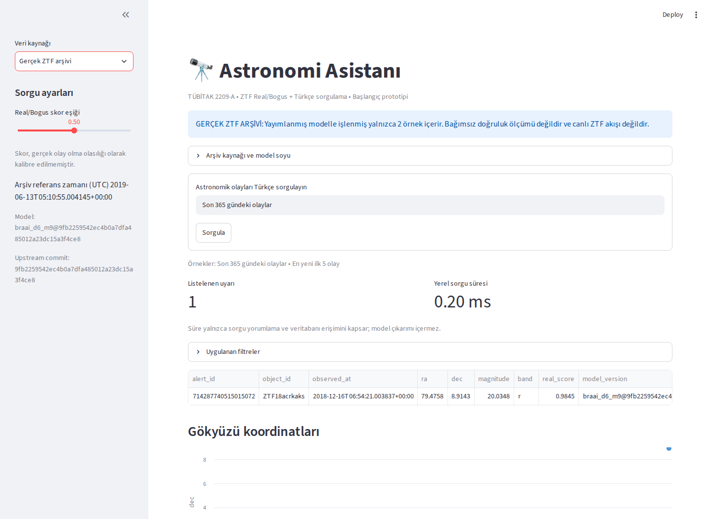

# Gerçek ZTF arşiv arayüzü



Chromium ile gerçek tarayıcı kontrolünde kaynak seçimi ve tekrar demoya dönüş
çalıştırıldı; ekran görüntüsü görsel olarak incelendi. Kaynak ve gözlem zamanları
görünür, arşiv ile demo uyarıları ayrıdır. [Tarayıcı kontrol kaydı](https://github.com/gulheda/ztf-astronomi-asistani/actions/runs/39030417841/job/117389575226).

Uygulama varsayılan olarak sentetik demo kayıtlarını gösterir. Kenar çubuğundaki
veri kaynağı seçicisinden **Gerçek ZTF arşivi** seçilerek sabitlenmiş iki gerçek
ZTF alert örneği incelenebilir. Örnekler ve model çıktıları
`docs/experiments/braai-2026-10-17/inference.json` dosyasındadır; dışarıdan canlı
arşive erişim yapılmaz.

Başlangıç eşiği 0.5, referans zamanı 2019-06-13T05:10:55.004145Z ve sorgu
aralığı 365 gündür. Bu nedenle yalnızca `ZTF18acrkaks` listelenir. Eşik 0'a
indirildiğinde ikinci örnek `ZTF19aazgdzh` de görünür. Gerçek kayıtların gözlem
tarihleri 2018-12-16 ve 2019-06-13'tür; bu tarihler güncel gözlemler değildir.

Skorlar, sabitlenmiş `braai_d6_m9` model ağırlıklarından üretilmiştir. Bu iki
örnek bağımsız doğruluk verisi oluşturmaz. Bu iki örnekle yeniden model eğitimi
veya bağımsız doğruluk ölçümü yapılmaz; skorlar kalibre olasılık değildir.
Arayüzde gerçek olay türü etiketi yoktur.
SNAD veri kümesi ve sınıfları bu iki alert arşivinden ayrı tutulur.

Tablo, gökyüzü dağılımı ve CSV dışa aktarımı aynı filtrelenmiş sonuçları kullanır.
CSV düğmesi grafiğin altındadır. Model sürümü ve kaynak URL bilgisi korunur.
Kaynaklar her geçişte ayrı bir bellek içi veritabanına yüklenir; iki modun
kayıtları birleştirilmez. Sorgu metinleri de ayrı tutulur.

Arşiv yükleyicisi sabitlenmiş iki uyarı kimliğini, model/commit/kaynak eşleşmesini,
bildirilen kaynak boyutu ve SHA256 tanımlarını, UTC referansını ve kayıt alanlarını
denetler. Dosya 1 MB ile sınırlıdır. Hatalı arşiv açık bir hata gösterir ve sorgu
başlatılmaz. Bu şema/köken kontrolüdür; yeni bir model çıkarımı veya bağımsız
bilimsel doğrulama değildir.

Proje kökünde uygulamayı çalıştırın:

```sh
.venv/bin/python -m streamlit run app.py
```
