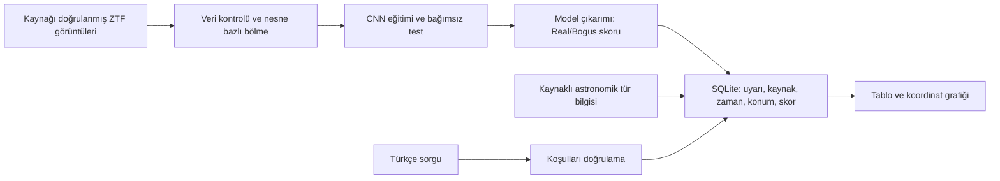

# Uygulama planı

Hazırlık tarihi: 17 Ekim 2026. Başlangıç durumu: boş çalışma klasörü; kullanıcı mevcut kod/veri/model bulunmadığını belirtti. Güncel teslim tarihi henüz verilmedi.

## Araştırma sorusu

Real/Bogus filtresinin ardından kullanılan sınırlı Türkçe sorgu arayüzü, uzman olmayan öğrencilerin aynı astronomi görevlerini doğru tamamlama süresini ve teknik işlem sayısını azaltıyor mu?

Model doğruluğu ve erişilebilirlik ayrı sonuçlardır. CNN başarı oranı tek başına kullanıcı erişilebilirliği hipotezini doğrulamaz.

## Kapsam

İlk sürüm: doğrulanmış etiketli ZTF alt kümesi, sade CNN, SQLite, anahtar kelime tabanlı Türkçe sorgu, tablo ve gökyüzü koordinat dağılımı. Başlangıçta arşiv verisiyle tekrar oynatma yeterlidir. Kesintisiz canlı akış, büyük dil modeli, yeni astronomik anomali keşfi ve bağımsız süpernova sınıflandırıcısı ilk sürümün hedefi değildir.

## Aşamalar ve kabul ölçütleri

Süreler emek tahminidir; resmi proje takvimi yerine geçmez. Öneride başlangıç 1 Mart 2026, son analiz 1 Aralık 2026; metinde ayrıca 12 ay yazıyor. Bu tutarsızlık ve güncel teslim tarihi danışmanla netleştirilmeli. Aşağıdaki haftalar yeni başlangıca göredir.

| Aşama | Tahmin | Somut çıktı | Tamamlanma ölçütü |
|---|---|---|---|
| İP1: kapsam ve kaynak doğrulama | Hafta 1 | Veri kaynağı kaydı, mimari, literatür tablosu | Etiketli dosya ve kullanım koşulları doğrulanmış |
| İP2: veri hazırlığı | Hafta 2 | Tekrarlanabilir veri dönüştürücü, kalite raporu, bölme listeleri | Tekrarlar incelenmiş; nesneler bölmeler arasında ayrık |
| İP3: CNN | Hafta 3–4 | Baseline, CNN, eğitim kayıtları, test raporu | Ayrılmış testte %85 hedefi değerlendirilmiş; precision/recall da raporlanmış |
| İP4: sorgulama | Hafta 3–4 | Türkçe niyet/koşul çözümleme, gerçek skor veritabanı | Önceden belirlenen sorgu setinde doğru sonuçlar ve açık hatalar |
| İP5: entegrasyon | Hafta 5–6 | Görüntüden sorgu sonucuna çalışan prototip | Gerçek bir kayıt için kaynak, görüntü, model, skor izlenebilir |
| İP6: değerlendirme | Hafta 7–8 | Kullanıcı pilotu, 15–20 kişilik çalışma, rapor | Görev başarısı, süre, işlem sayısı ve hata analizi raporlanmış |

## İlk hafta yapılacaklar

1. Braai eğitim not defterinde bulunan CSV/NPY adreslerini (`KAYNAKLAR.md`) kullanarak güncel erişimi, etiket üretimini ve lisansı doğrula. Adreslerin bulunması tamamlandı; dosya doğrulaması bekliyor.
2. Önerideki 1.2 GB veri ifadesini gerçek kaynakla eşleştir; eşleşmezse danışmana sunulacak veri seçimi notunu hazırla.
3. 100–500 gerçek örneği indirip kanal sırası, kimlik, NaN, boyut, sınıf dağılımını incele. Bu sayı yöntem denemesi içindir, başarı iddiası için yeterlilik varsayımı değildir.
4. Dosya SHA256, kaynak URL, indirme tarihi ve insan/otomatik etiket ayrımını kaydet.
5. Görüntülerle zaman/konum meta verisini ortak `alert_id` üzerinden eşleştir.
6. Kaynak uygunsa dönüştürücüyü ve görsel veri kontrolünü tamamla; sonrasında eğitim başlat.

## İş paylaşımı önerisi

İsimlere kesin görev ataması yapılmadı. Üç kişilik ekip için veri/kalite, CNN/deney ve sorgu/arayüz sorumlulukları paylaşılabilir. Her deney başka bir ekip üyesi tarafından tekrar çalıştırılmalı. Danışmanla veri seçimi, değerlendirme tasarımı ve kapsam değişiklikleri birlikte incelenmeli.

## Riskler ve kararlar

- Veri bulunamazsa başka bir doğrulanmış ZTF etiketli kaynak araştırılır. Galaxy Zoo, TESS veya SDSS'ye geçmek aynı Real/Bogus deneyinin eşdeğeri sayılmaz; araştırma sorusu yeniden tanımlanmalıdır.
- Sınıf dengesizliğinde çoğunluk baseline ve balanced accuracy raporlanır; yalnız accuracy üzerinden başarı kararı verilmez.
- %85 hedefi sağlanmazsa veri kalitesi ve hatalar incelenir; artırma/transfer öğrenmesi yalnız eğitim/doğrulama üzerinde denenir. Test seti ayar için kullanılmaz.
- Entegrasyon gecikirse CLI korunur; arayüz ve model ayrı doğrulanabilir parçalar halinde teslim edilir.
- Canlı veri gereksinimi oluşursa erişim yöntemi ve saklama planı ayrıca tasarlanır.
