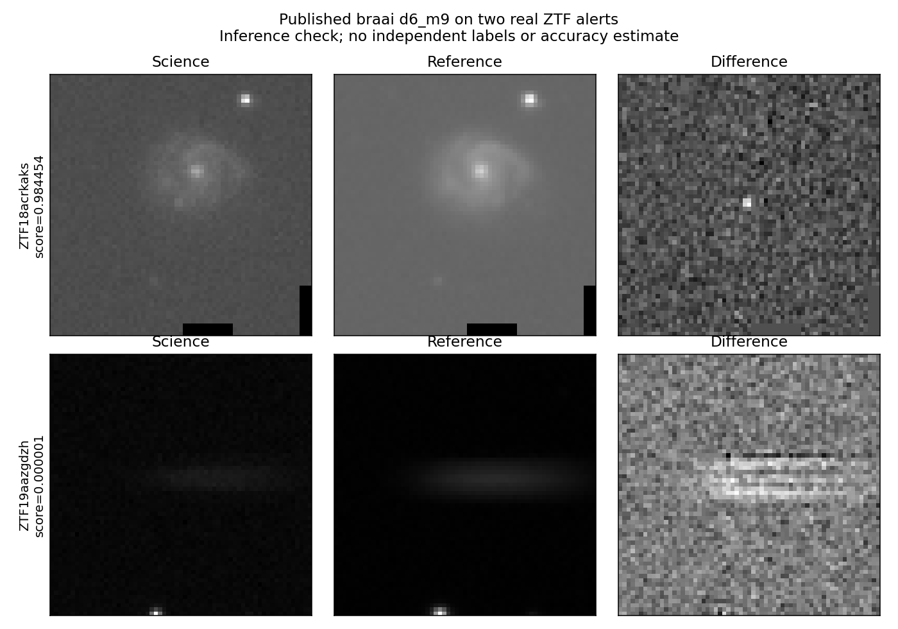

# İlk gerçek ZTF çıkarım deneyi

17 Ekim 2026'da yayımlanmış **braai d6_m9** ağırlıkları, upstream depoda sağlanan iki gerçek ZTF uyarısına uygulandı. Kendi modelimiz eğitilmedi. Bağımsız gerçek etiketler bulunmadığı için accuracy hesaplanmadı.

Başarılı [model ve güvenlik çalışması](https://github.com/gulheda/ztf-astronomi-asistani/actions/runs/39024684800), [genel test/güvenlik çalışması](https://github.com/gulheda/ztf-astronomi-asistani/actions/runs/39024684797). Uygulama dalındaki kod: `4a8f15d`; kaynak braai commit'i: `9fb2259542ec4b0a7dfa485012a23dc15a3f4ce8`. Ortam: Python 3.11, TensorFlow 2.21.0, NumPy 1.26.4.

| Nesne | Uyarı | Gözlem zamanı (UTC) | braai skoru |
|---|---|---|---:|
| ZTF18acrkaks | 714287740515015072 | 2018-12-16 06:54:21.003837 | 0.9844534993 |
| ZTF19aazgdzh | 893215910715010007 | 2019-06-13 05:10:55.004145 | 0.000000866756 |

Skorlar kalibre edilmiş olasılık veya doğrulanmış fiziksel tür değildir. Önceki `rb` model skorları JSON'da karşılaştırma bilgisi olarak saklanır; gerçek etiket kabul edilmez. Bu örneklerin yayımlanmış modelin eğitiminden bağımsız olduğu kanıtlanmadı; genel başarım iddiası kurulamaz.



Görüntü görsel olarak incelendi. İlk uyarının her kanalında 72 NaN piksel var; upstream ön işleme kuralıyla sıfırlandılar ve rapora kaydedildiler. İkinci uyarıda NaN yok. Kanal sırası science/reference/difference. İki uyarıda da kesitler 63×63.

## Uçtan uca kontrol

Skorlar `is_demo=0`, kaynak URL ve model sürümüyle SQLite'a yazıldı. Referans zamanı ikinci uyarının gözlem zamanı olarak seçildi. `Son 365 gündeki olaylar` sorgusu ve 0.5 eşik ile yalnız `714287740515015072` döndü. GitHub artifact'indeki veritabanı indirilip aynı sorgu yerelde tekrarlandı; aynı sonuç alındı.

```bash
python -m pip install -r requirements-inference.txt
python -m astro_assistant.braai --output output/real-inference
python -m astro_assistant --db output/real-inference/alerts.sqlite --at 2019-06-13T05:10:55.004145+00:00 "Son 365 gündeki olaylar"
```

Her çalıştırma yeni bir çıktı klasörü kullanmalı. Yeniden üretimde küçük kayan nokta farkları olabilir.

## Doğrulama ve güvenlik

Genel işte 38 test keşfedildi: 35 geçti; 3 FITS testi Astropy bu ortamda kurulmadığı için atlandı. Gerçek çıkarım işinde bu 3 FITS testi ve 2 kaynak doğrulama testi geçti. Ayrıca gerçek model dosyası yüklenip her iki uyarıda çıkarım tamamlandı. Bu testler bilimsel accuracy ölçümü değildir.

Her iki ortamda `pip-audit` bilinen açık bulmadı. Önceki taramada runner'ın setuptools 79.0.1 sürümünde bildirilen `PYSEC-2026-3447`, araç ortamı ≥83 sürümüne yükseltilerek giderildi. Taramadaki sıfır bulgu, tüm olası açıkların bulunmadığını garanti etmez; tarihli bir bağımlılık kontrolüdür.

## Kaydedilen kanıtlar

- [Ham çıkarım raporu ve kaynak SHA256 değerleri](inference.json)
- [Çıkarım anındaki paket sürümleri](environment.txt). İlk kayıt audit aracı kurulmadan önce alındı; setuptools güvenlik yükseltmesi sonraki adımda yapıldı. Bu dosya kurulum kilidi olarak kullanılmamalı. Yeni workflow, ortamı güvenlik adımından sonra kaydeder; yeniden üretim için `requirements-inference.txt` kullanılır.
- [Son bağımlılık taraması: 61 paket, 0 bulgu](dependency-audit.json)
- SQLite ve diğer çıktılar yukarıdaki GitHub çalışmasının `real-ztf-inference` artifact'inde 30 gün saklanır; daha sonra komutla yeniden üretilebilir.

Kaynak model ve örnekler: [Dmitry Duev / braai](https://github.com/dmitryduev/braai). Yöntem: [Duev ve arkadaşları, 2019](https://doi.org/10.1093/mnras/stz2357). Lisans atfı: [THIRD_PARTY_NOTICES.md](../../../THIRD_PARTY_NOTICES.md).
