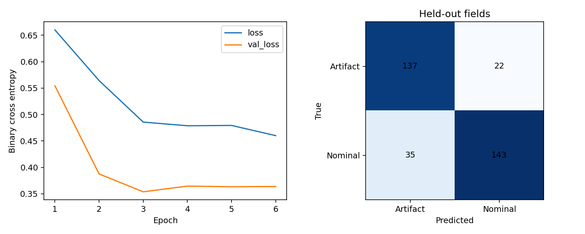

# İlk gerçek SNAD nominal/artefakt eğitimi

17 Ekim 2026. [Başarılı eğitim ve güvenlik çalışması](https://github.com/gulheda/ztf-astronomi-asistani/actions/runs/39027528682). Çalıştırılan PR merge commit'i `c026b2b7e23f8aed74249c6b3e9cddecdc79d64a`; kaynak dalı `b186c0d`. [Önceden sabitlenen deney planı](../../SNAD_PILOT_PLANI.md).

## Veri ve bağımsız bölme

2146 görüntü kabul edildi. **108 artefakt (%9,58) eksik boyut nedeniyle dışlandı; nominal dışlama olmadı.** Bu asimetrik seçim, sonuçların yalnız kabul edilen 63×63 alt kümesine ait olduğu anlamına gelir. Kenar/eksik kesit başarımı ölçülmedi. NaN/Inf, eksik zorunlu metadata veya aynı ham görüntü/piksel/OID tekrarı bulunmadı. FITS başlıklarında 40 FIELDID gözlendi; makaledeki ışık eğrisi alan seçimiyle aynı küme varsayılmadı.

| Bölüm | Görüntü | Artefakt / nominal | Alan |
|---|---:|---:|---:|
| Eğitim | 1477 | 703 / 774 | 28 |
| Doğrulama | 332 | 157 / 175 | 6 |
| Test | 337 | 159 / 178 | 6 |

Seed42. Alan, OID ve 1 yay saniyesi koordinat bağlantıları aynı bölümde tutuldu. İkinci ajan manifest ayrıklığını kontrol etti ve tahminlerden metrikleri yeniden hesaplayarak JSON ile eşleştirdi.

## Test sonucu

0=artefakt, 1=nominal; eşik 0.5.

| Model | Accuracy | Balanced accuracy | Nominal recall | Artefakt recall | ROC-AUC |
|---|---:|---:|---:|---:|---:|
| Eğitim çoğunluğu | %52,82 | — | — | — | — |
| Görüntü özellikleri + lojistik regresyon | %89,91 | %89,81 | %91,57 | %88,05 | 0,9676 |
| Küçük CNN | %83,09 | %83,25 | %80,34 | %86,16 | 0,9311 |

Bu bölmede lojistik regresyon daha iyi. Genel model üstünlüğü iddia edilmiyor. CNN 6 epoch sonunda erken durdu; en iyi validation loss 3. epoch'ta, o ağırlıklar geri alındı. Test, model/eşik seçmekte kullanılmadı.

CNN matrisi `[[137,22],[35,143]]`; lojistik matris `[[140,19],[15,163]]`. Satırlar gerçek, sütunlar tahmin; artefakt/nominal sırası.



Bu **tek kanallı SNAD nominal/artefakt** pilotudur; canlı uyarı Real/Bogus doğruluğu değildir. Kaynağın uzman seçimi, asimetrik dışlamalar, tek seed ve yalnız altı test alanı genellenebilirliği sınırlar. Güven aralıkları hesaplanmadı. Projedeki %85 hedefinin karşılandığı iddia edilmez. Test artık görülmüştür: yeni ayarlar yalnız eğitim/doğrulamada seçilmeli; nihai başarı için yeni bağımsız alan/zaman verisi gerekir. Eksik kesitlerin padding/mask ile korunması ayrı, önceden tanımlı kontrol deneyi olmalı.

## Kanıtlar

[Metrikler](metrics.json), [test tahminleri](test_predictions.json), [bölme manifesti](split_manifest.json), [veri kalite kaydı](data-audit.json), [eğitim geçmişi](history.json), [paketler](environment.txt), [güvenlik taraması: sıfır bilinen bulgu](dependency-audit.json).

Eğitilmiş `model.keras`, yukarıdaki GitHub çalışmasının `snad-pilot` artifact'inde 30 gün saklanır. [Model SHA256](model-reference.json). Ham veri ve ağırlıklar Git deposuna eklenmedi.

```bash
python -m pip install -r requirements-pilot.txt
python -m astro_assistant.snad_train --output output/snad-pilot --epochs 12
```

Yeni çıktı klasörü gerekli. Paket/CPU farkları küçük sayısal değişiklikler yaratabilir. Kaynak: [SNAD Zenodo 15076426](https://doi.org/10.5281/zenodo.15076426), CC-BY-4.0; [Sreejith ve arkadaşları, 2025](https://arxiv.org/abs/2504.08053).
